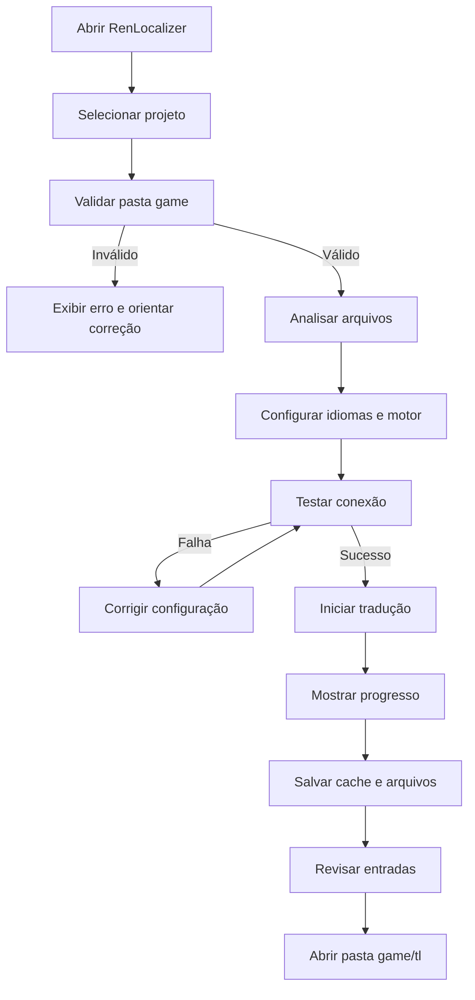

# UI ideal para o RenLocalizer

## 1. Conceito

O RenLocalizer deve ser uma aplicação desktop focada em três tarefas:

1. Selecionar um projeto Ren'Py.
2. Traduzir os textos com segurança.
3. Revisar e exportar os arquivos para `game/tl/<idioma>/`.

A interface deve funcionar como um **painel de tradução por projeto**, mostrando claramente o estado dos arquivos, da tradução e da saída gerada.

## 2. Estrutura principal

```text
┌─────────────────────────────────────────────────────────────┐
│ RenLocalizer                           Projeto ▾   ⚙        │
├──────────────┬──────────────────────────────────────────────┤
│              │                                              │
│  Visão geral │              Conteúdo principal               │
│  Projeto     │                                              │
│  Tradução    │                                              │
│  Revisão     │                                              │
│  Arquivos    │                                              │
│  Configurações│                                             │
│              │                                              │
├──────────────┴──────────────────────────────────────────────┤
│ Status: Pronto                         Motor: LibreTranslate │
└─────────────────────────────────────────────────────────────┘
```

### Navegação lateral

- **Visão geral**
- **Projeto**
- **Tradução**
- **Revisão**
- **Arquivos gerados**
- **Glossário**
- **Configurações**

A navegação deve permanecer visível durante o uso. O usuário precisa conseguir consultar arquivos e configurações sem perder o estado atual.

## 3. Tela de primeiro uso

Quando nenhum projeto foi configurado:

```text
RenLocalizer

Traduza seu projeto Ren'Py com segurança.

[ Abrir projeto Ren'Py ]

Projetos recentes
Nenhum projeto aberto ainda
```

Ao selecionar um caminho, a aplicação deve localizar automaticamente:

```text
MeuJogo/
└── game/
```

Se a pasta `game/` não existir, deve informar o problema imediatamente:

```text
Este diretório não parece ser um projeto Ren'Py.
A pasta "game" não foi encontrada.

[ Escolher outra pasta ]
```

## 4. Visão geral do projeto

Depois de abrir um projeto, a tela principal deve mostrar um resumo operacional:

```text
MeuJogo
C:\Games\MeuJogo

┌────────────────────┬────────────────────┬────────────────────┐
│ Arquivos .rpy      │ Textos encontrados │ Traduções em cache │
│ 42                 │ 1.284              │ 936                │
└────────────────────┴────────────────────┴────────────────────┘

Idioma de origem     Inglês
Idioma de destino    Português do Brasil
Motor                LibreTranslate
Destino              game/tl/portuguese/

[ Analisar projeto ]  [ Iniciar tradução ]
```

### Indicadores importantes

- Quantidade de arquivos `.rpy`.
- Quantidade de arquivos `.rpyc`.
- Quantidade de arquivos `.rpa`.
- Quantidade de entradas extraídas.
- Quantidade de traduções presentes no cache.
- Quantidade de entradas pendentes.
- Última execução.
- Local dos arquivos gerados.

O botão **Iniciar tradução** deve ficar desabilitado até que o projeto seja validado.

## 5. Configuração do projeto

```text
Projeto Ren'Py

Pasta do projeto
[C:\Games\MeuJogo                         ] [Selecionar]

Pasta detectada
C:\Games\MeuJogo\game             ✓ Encontrada

Arquivos detectados
✓ Arquivos .rpy: 42
✓ Arquivos .rpyc: 8
! Arquivos .rpa: 2
```

### Opções de análise

```text
[ ] Fazer varredura profunda
[ ] Ler arquivos .rpyc
[ ] Extrair arquivos .rpa
[ ] Ler arquivos .rpymc
[ ] Preparar textos não marcados com _()
```

Cada opção deve ter uma descrição curta sobre seu efeito.

## 6. Tela de tradução

```text
Tradução

Idioma de origem
[ Inglês                         ▾ ]

Idioma de destino
[ Português do Brasil            ▾ ]

Motor de tradução
[ LibreTranslate                 ▾ ]

Endpoint
[ http://localhost:5000/translate ]

Tamanho do lote
[ 100 ]

Tentativas em caso de erro
[ 3 ]

Timeout
[ 60 segundos ]

[ Testar conexão ]       [ Salvar configuração ]
```

### Estado da conexão

```text
LibreTranslate
● Conectado
Última verificação: agora
```

Ou:

```text
LibreTranslate
● Não conectado
Verifique se o serviço está disponível em localhost:5000.

[ Tentar novamente ]
```

A interface deve impedir o início da tradução quando o motor não estiver acessível, exceto em um modo explícito de extração sem tradução.

## 7. Tela de execução

Durante o processamento, a tela deve apresentar progresso real por etapa:

```text
Traduzindo MeuJogo

Validando projeto                  ✓
Lendo arquivos Ren'Py              ✓
Extraindo textos                   ✓
Traduzindo entradas                63%
Gerando arquivos de saída          aguardando

██████████████░░░░░░░░  63%

804 de 1.284 entradas
936 entradas recuperadas do cache
2 falhas

[ Pausar ]  [ Cancelar ]
```

### Etapas exibidas

- Validando projeto.
- Localizando arquivos.
- Extraindo textos.
- Protegendo placeholders.
- Traduzindo.
- Restaurando placeholders.
- Salvando cache.
- Gerando `dialogue.rpy`.
- Gerando `strings.rpy`.
- Gerando arquivo de idioma.

Os logs devem ficar em um painel recolhível:

```text
Detalhes da execução ▾

[12:44:02]  Tradução iniciada
[12:44:03]  Cache encontrado para "Start"
[12:44:04]  Entrada traduzida: label_start_91ac...
```

## 8. Tela de revisão

A revisão é necessária porque traduções automáticas podem alterar nomes, variáveis ou placeholders.

```text
Revisão de traduções

Filtros:
[ Todas ▾ ] [ Buscar texto...                    ] [ Somente pendentes ]

┌─────────────┬──────────────────────────────┬──────────────────────────────┬──────┐
│ Tipo        │ Original                     │ Tradução                    │ Estado│
├─────────────┼──────────────────────────────┼──────────────────────────────┼──────┤
│ Diálogo     │ Hello, [player]              │ Olá, [player]                │ ✓    │
│ Menu        │ Start                        │ Iniciar                      │ ✓    │
│ Narração    │ {points} points remaining    │ Restam {points} pontos       │ !    │
└─────────────┴──────────────────────────────┴──────────────────────────────┴──────┘
```

Ao selecionar uma entrada:

```text
Original
The player has [points] points.

Tradução
O jogador tem [points] pontos.

Arquivo
game/script.rpy
Linha 84
Contexto
label start

[ Editar tradução ] [ Marcar como revisada ]
```

### Filtros recomendados

- Todas.
- Pendentes.
- Traduzidas.
- Com erro.
- Vindas do cache.
- Diálogos.
- Narrações.
- Escolhas.
- Strings de interface.
- Arquivo específico.
- Label específico.

### Problemas que devem ser destacados

- Placeholder ausente.
- Placeholder alterado.
- Texto vazio.
- Tradução idêntica ao original.
- Erro de comunicação com o motor.
- Entrada duplicada.

## 9. Tela de arquivos gerados

```text
Arquivos gerados

✓ game/tl/portuguese/dialogue.rpy
  1.012 entradas

✓ game/tl/portuguese/strings.rpy
  272 entradas

✓ game/zzz_renlocalizer_language.rpy
  Arquivo de ativação do idioma

✓ extracted_entries.json
  1.284 entradas

✓ cache.json
  936 traduções armazenadas
```

Ações disponíveis:

- Abrir arquivo.
- Abrir pasta.
- Copiar caminho.
- Comparar com execução anterior.
- Exportar relatório.

A ação principal deve ser **Abrir pasta de tradução**.

## 10. Glossário

O `ConfigManager` já prevê suporte a glossário. A UI deve oferecer uma tela própria:

```text
Glossário

Termo original              Tradução preferida
[ save                  ]    [ salvar                 ]
[ inventory             ]    [ inventário              ]
[ guild                 ]    [ guilda                  ]

[ + Adicionar termo ]

[ Importar JSON ] [ Exportar JSON ] [ Salvar glossário ]
```

## 11. Configurações

As configurações devem ser divididas por categoria.

### Projeto

- Caminho do projeto.
- Caminho do JSON de entradas.
- Caminho do cache.
- Caminho de `dialogue.rpy`.
- Caminho de `strings.rpy`.

### Tradução

- Idioma de origem.
- Idioma de destino.
- Motor selecionado.
- Tamanho do lote.
- Número de tentativas.
- Timeout.
- Uso de cache.
- Preservação de placeholders.

### Interface

- Tema claro, escuro ou sistema.
- Idioma da interface.
- Projeto aberto recentemente.
- Confirmação antes de sobrescrever arquivos.

Configurações avançadas devem ficar recolhidas para não sobrecarregar o fluxo principal.

## 12. Estados essenciais

A UI deve tratar explicitamente estes estados:

```text
Nenhum projeto aberto
Projeto carregando
Projeto válido
Projeto inválido
Motor desconectado
Pronto para traduzir
Traduzindo
Tradução pausada
Tradução cancelada
Tradução concluída
Tradução concluída com erros
Falha ao salvar arquivos
```

Cada estado deve indicar:

- O que aconteceu.
- O que o usuário pode fazer agora.
- Qual ação é recomendada.

Exemplo:

```text
Tradução concluída com avisos

1.276 entradas foram processadas.
8 entradas precisam de revisão.
Os arquivos foram gerados normalmente.

[ Revisar entradas ] [ Abrir arquivos ]
```

## 13. Direção visual

- Interface desktop compacta e funcional.
- Fundo neutro, com alto contraste.
- Azul para informação.
- Verde para concluído.
- Amarelo para atenção.
- Vermelho para erro.
- Tabelas densas para revisão.
- Cards apenas para métricas e resultados individuais.
- Tipografia legível para textos longos.
- Ícones para abrir pasta, atualizar, iniciar, pausar, cancelar e configurações.
- Tema escuro opcional, respeitando a configuração existente.

A interface deve priorizar leitura e acompanhamento do processamento, porque o usuário trabalhará com centenas ou milhares de entradas.

## 14. Fluxo ideal do usuário



## 15. MVP recomendado

A primeira versão da UI deve implementar:

1. Seleção de projeto.
2. Validação da pasta `game/`.
3. Seleção de idioma e motor.
4. Indicadores de arquivos e entradas.
5. Execução em segundo plano.
6. Progresso por etapa.
7. Logs recolhíveis.
8. Resultado com links para os arquivos gerados.
9. Lista simples de entradas com erro.
10. Persistência usando o `config.json` existente.

A revisão avançada, glossário e suporte a `.rpa`/`.rpyc` podem entrar na segunda etapa.

## 16. Ajuste técnico necessário

O `TranslationPipeline` atual retorna o resultado somente ao final e registra progresso por `logging`. Para sustentar essa UI, ele deve receber um callback ou emitir eventos:

```python
progress_callback(
    stage="TRANSLATING",
    current=804,
    total=1284,
    message="Entrada traduzida",
)
```

Assim, a interface poderá atualizar o progresso sem bloquear e sem depender da leitura de texto dos logs.
